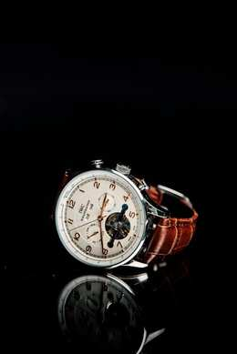
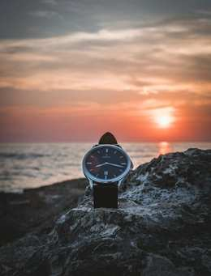
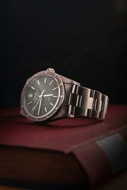

## Áurea Relógios

Catálogo demonstrativo de relógios desenvolvido como projeto escolar em HTML e CSS.

- **Curso:** Informática para Internet
- **Turma:** IFTP
- **Unidade curricular:** Versionamento e colaboração
- **Professor:** Josué Rodrigo Evangelista Figueirêdo
- **Data:** 13/11/2026

## Integrantes

- João Augusto dos Anjos Nolasco
- Daniel Heitor Silva Cortes
- Davi Jelinuir Neves

## Apresentação do projeto

A **Áurea Relógios** é um site de página única que apresenta três modelos de relógios: Atlantic, Verona e Eclipse. Cada produto possui imagem, nome, descrição e preço.

O projeto reúne essas informações em um catálogo organizado, facilitando a consulta e a comparação dos modelos.

Foi desenvolvido para praticar a estruturação de páginas com HTML, a estilização com CSS, a responsividade e a documentação de projetos.

*Este é um projeto escolar. A loja, os preços e os dados de contato são demonstrativos. O site não realiza vendas.*

## Objetivos

- Organizar fotos, descrições e preços em uma única página.
- Facilitar a consulta e a comparação dos relógios.
- Oferecer navegação simples entre as seções.
- Adaptar a apresentação para computadores e celulares.
- Aplicar conhecimentos de HTML, CSS e versionamento de código.

## Funcionalidades

- **Catálogo:** apresenta três modelos com imagens, descrições e preços.
- **Menu de navegação:** permite acessar as seções Produtos, Sobre e Contato.
- **Botões de consulta:** direcionam o usuário à seção de contato.
- **Seção Sobre:** explica a proposta da loja e o caráter escolar do projeto.
- **Contato demonstrativo:** apresenta um endereço de e-mail fictício.
- **Perguntas frequentes:** permite abrir e fechar respostas.
- **Retorno ao início:** disponibiliza um link no rodapé.
- **Layout responsivo:** reorganiza os produtos conforme o tamanho da tela.

**Os botões de consulta não verificam estoque nem enviam mensagens.** O site não possui cadastro, login, carrinho, pagamento ou banco de dados.

---

## Tecnologias utilizadas

| Tecnologia ou ferramenta | Finalidade |
| --- | --- |
| HTML5 | Estrutura e conteúdo da página |
| CSS3 | Estilização e responsividade |
| Visual Studio Code | Edição dos arquivos |
| Git | Versionamento do código |
| GitHub | Armazenamento e compartilhamento do projeto |
| JPEG | Formato das imagens dos relógios |

O layout utiliza **Flexbox** e **media queries** para ajustar a apresentação dos elementos.

As perguntas frequentes utilizam os elementos nativos `<details>` e `<summary>` do HTML, sem necessidade de JavaScript.

## Estrutura do projeto

```text
Aurea-project/
├── imagens/
│   ├── atlantic.jpg
│   ├── eclipse.jpg
│   └── verona.jpg
├── README.md
├── aurea.css
└── index.html
```

| Arquivo ou pasta | Descrição |
| --- | --- |
| index.html | Contém a estrutura e o conteúdo da página |
| aurea.css | Define cores, fontes, espaçamentos e responsividade |
| imagens/ | Armazena as fotografias dos produtos |
| imagens/atlantic.jpg | Fotografia do relógio Atlantic |
| imagens/eclipse.jpg | Fotografia do relógio Eclipse |
| imagens/verona.jpg | Fotografia do relógio Verona |
| README.md | Apresenta a documentação do projeto |

## Como executar o projeto

É necessário apenas um navegador, como Google Chrome, Microsoft Edge ou Firefox.

1. Acesse o repositório do projeto.
2. Clique em **Code** e depois em **Download ZIP**.
3. Extraia o arquivo baixado.
4. Abra a pasta do projeto.
5. Abra o arquivo `index.html` no navegador.
6. Utilize o menu para navegar pelas seções e clique nas perguntas frequentes para visualizar as respostas.

**Mantenha o arquivo `aurea.css` e a pasta `imagens` na organização original para que os estilos e as fotos sejam carregados corretamente.**

Não é necessário instalar dependências, compilar arquivos ou configurar banco de dados.

---

## Imagens dos produtos

### Relógio Atlantic



*Modelo apresentado no catálogo com descrição e preço demonstrativo.*

### Relógio Eclipse



*Modelo com visual marcante, apresentado entre as opções do catálogo.*

### Relógio Verona



*Modelo apresentado como uma opção para ocasiões especiais.*

## Melhorias futuras

1. Adicionar uma busca por nome dos relógios.
2. Implementar filtros por faixa de preço.
3. Criar páginas com especificações detalhadas dos produtos.
4. Adicionar um formulário de contato com validação e envio de mensagens.
5. Aprimorar a acessibilidade com testes de contraste e navegação por teclado.
6. Otimizar as imagens para melhorar o carregamento.

*Essas melhorias são propostas para versões futuras e ainda não estão implementadas.*

## Repositório

[Acessar o projeto no GitHub](https://github.com/16116WEB/Aurea-project)
